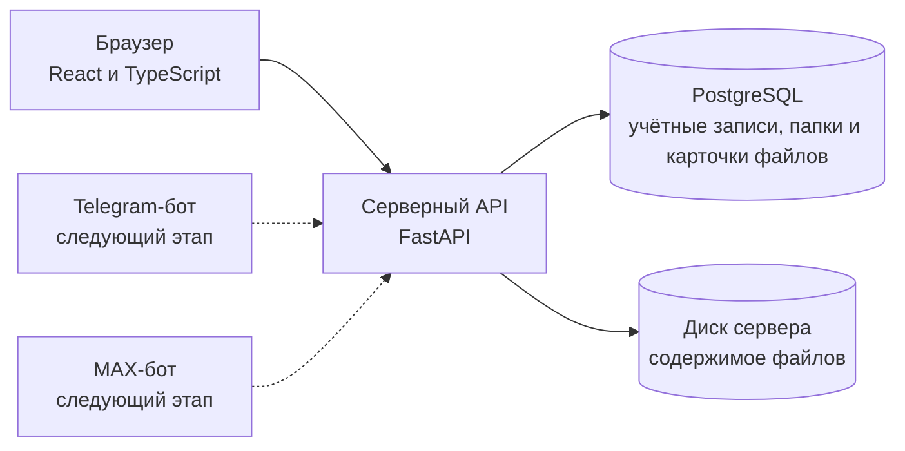
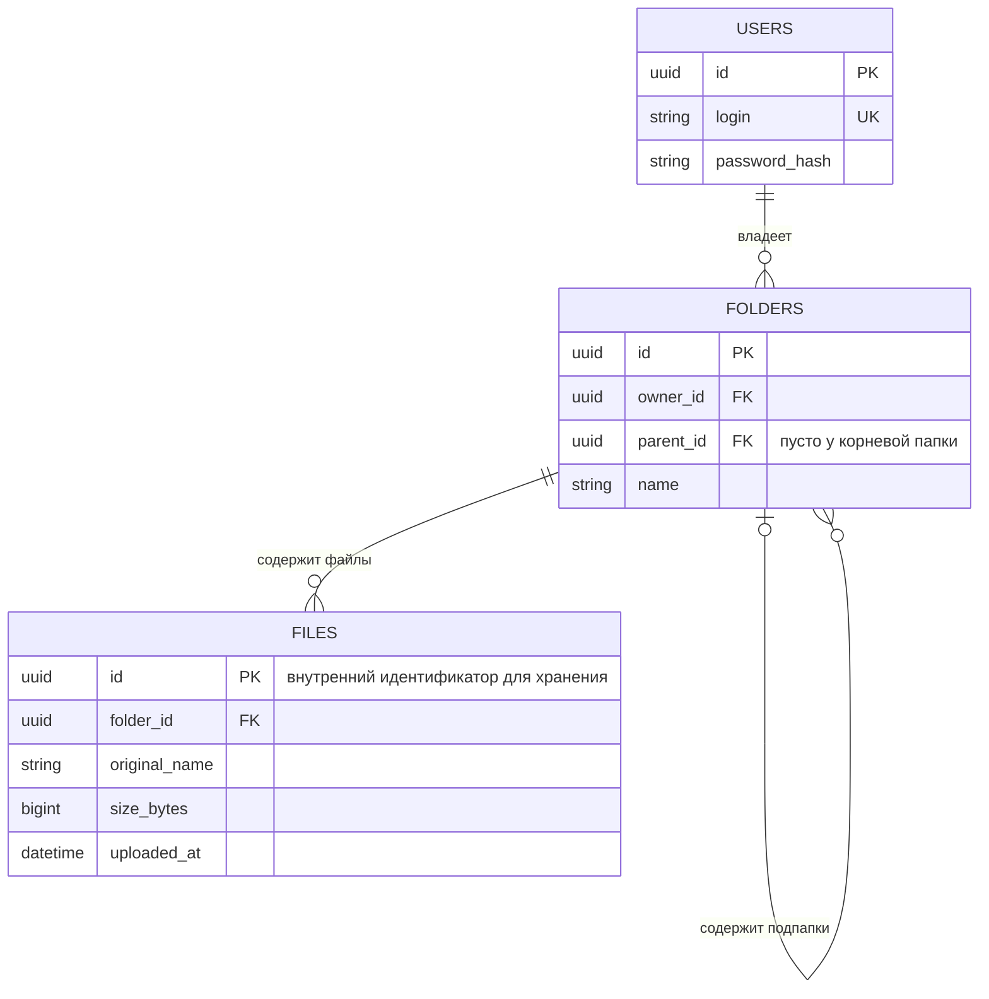

# Архитектура облачного файлового хранилища

Локальный прототип предусматривает вход через браузер, создание папок, загрузку и скачивание файлов. Браузер обращается к FastAPI. Весной Telegram-бот и MAX-бот будут отдельно обращаться к тому же API от имени привязанной учётной записи.

FastAPI проверяет права доступа и управляет записью данных. PostgreSQL и загруженные файлы используют отдельные постоянные тома. Недоступность одного бота затрагивает только его канал, поскольку браузер и второй бот обращаются к API независимо.

## Черновая ER-диаграмма

PostgreSQL хранит логин, хеш пароля, структуру папок, их владельцев и сведения о файлах. Диск хранит байты файла под внутренним идентификатором. Исходное имя используется в списке и при скачивании.

## Сценарий с `test.pdf`

1. После входа пользователь открывает свою папку. Сервер определяет пользователя по данным входа и проверяет владельца папки перед чтением её содержимого или добавлением файла.
2. При загрузке `test.pdf` сервер записывает байты во временный файл в томе для загрузок. После завершения записи он атомарно переименовывает файл внутри этого тома, используя внутренний идентификатор, затем сохраняет карточку в PostgreSQL. Список строится по сохранённым карточкам, поэтому прерванная загрузка в нём не появляется. При аварийной остановке между переименованием и сохранением карточки на диске может остаться файл без записи в базе.
3. При скачивании сервер находит карточку, проверяет владельца её папки и отдаёт содержимое с именем `test.pdf`. Если второй пользователь откроет тот же адрес, сервер отклонит запрос после проверки владельца.
